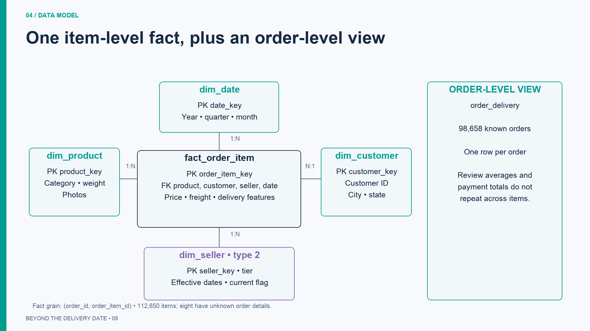

# Beyond the Delivery Date

Our client is the Head of Marketplace Operations at a Brazilian online marketplace. They want to improve delivery reliability and understand how the delivery experience relates to customer satisfaction. Using Olist's historical orders, we built a BigQuery warehouse and analysed delivery promises, customer reviews, freight charges, and seller performance.

The client asks five questions: **Where are late deliveries concentrated across routes and product categories? How do reviews differ between early, on-time, and late orders? Are regional delivery promises too optimistic? Does freight charged relative to merchandise value relate to satisfaction? How do outcomes compare across seller tiers under a simulated quarterly watchlist policy?**

**Team:** Michael Skinner and Sukhman Brar. [Partner's repository](https://github.com/2494-Gen-AI-CN/SukhmanBrar).

## Main findings

| Client question | What the data shows | What we recommend |
| --- | --- | --- |
| Where are deliveries late? | PR → AL has the highest eligible corridor rate: **14 of 43 items, 32.6%**. SP → RJ has a lower rate, **13.5%**, but **1,269 late items out of 9,403**. Audio leads eligible categories at **42 of 362 items, 11.6%**. | Prioritise both late volume and rate; small corridors need more observation before broad changes. |
| How do delays relate to reviews? | Average review falls from **4.294 for early orders** to **1.696 for orders 8+ days late**. Late orders are **6.7%** of reviewed delivered orders but account for **32.5%** of their 1–2 star reviews. | Investigate late-order causes and test proactive customer communication. |
| Are promises too optimistic? | Mean delivery duration is shorter than mean promised duration in **all 24 states with at least 100 delivered orders**. AL averages **24.5 actual versus 33.2 promised days**, yet **21.4%** of orders are late. | Investigate the late tail and regional variability; averages do not justify extending every promise. |
| Does freight share relate to satisfaction? | Order freight-to-merchandise ratio has a **Pearson correlation of −0.0238** with review score, a very weak linear association. Bucket averages range from **4.206 to 4.089**. | Do not prioritise blanket freight discounts on this evidence alone. |
| What does seller history show? | Delivered items tied to Standard versions have a **6.62%** late rate; Watchlist versions have **5.75%**. These are historical groups under a simulated rule. | Use the history to support seller review. The comparison does not establish that a watchlist improves performance. |

For **95,824 reviewed delivered orders**, signed days late versus review score has **Pearson r = −0.2674** and **Spearman ρ = −0.1764**. Early deliveries retain negative days; Spearman uses average ranks for ties. Longer delays tend to accompany lower scores, but product quality, seller differences, customer expectations, and review selection may also affect the relationship. These are associations, not causal estimates.

## Dataset and scope

[Brazilian E-Commerce Public Dataset by Olist](https://www.kaggle.com/datasets/olistbr/brazilian-ecommerce), covering 2016–2018. Attribution: Olist; licence **CC BY-NC-SA 4.0**. This project uses it for non-commercial education and an invented client scenario.

Download and extract these eight source files into `data/raw/`:

```text
olist_orders_dataset.csv
olist_order_items_dataset.csv
olist_products_dataset.csv
olist_customers_dataset.csv
olist_sellers_dataset.csv
olist_order_payments_dataset.csv
olist_order_reviews_dataset.csv
product_category_name_translation.csv
```

Geolocation is excluded because our questions use states rather than coordinates. The files contain **550,759 source records**, including **99,441 orders and 112,650 items**. Cleaning accepts **550,751 records**, rejects **8 orders**, and removes **0 duplicates** in this dataset. The rejected orders are marked delivered but lack a customer delivery date. Their eight items remain in the fact with `order_missing = TRUE` and unknown order outcomes.

## Pipeline

```text
Olist CSVs → pandas validation/cleaning → BigQuery p0_staging
                                            ├─ load_log + rejects
                                            └─ warehouse SQL → p0_warehouse
                                                                 └─ analysis SQL → Matplotlib charts → presentation
```

YAML defines source paths, CSV format, schemas, keys, cleaning rules, and BigQuery settings. A new source using the supported rules requires a configuration entry rather than another ingestion function. Clean records load directly to BigQuery staging through batch jobs; there is no intermediate database. Warehouse SQL builds one item fact, four dimensions, and supporting order-level objects.

## Run from a fresh clone

Use **Python 3.11 or newer**; this project was tested with Python 3.14. Install the [Google Cloud CLI](https://cloud.google.com/sdk/docs/install) for `gcloud` and `bq`.

```bash
git clone https://github.com/2494-Gen-AI-CN/MichaelSkinner.git
cd MichaelSkinner/projects/P0
python3 -m venv .venv
source .venv/bin/activate
pip install -r requirements.txt
cp .env.example .env
cp config/config.example.yaml config/config.yaml
```

Set `GCP_PROJECT` in `.env` to your project ID. Our shared project is **`olist-delivery-insights`**, with datasets `p0_staging` and `p0_warehouse` in **US**. Python reads `.env`; export the same project for terminal commands:

```bash
export GCP_PROJECT="your-project-id"
gcloud auth login
gcloud config set project "$GCP_PROJECT"
gcloud auth application-default login
bq --project_id="$GCP_PROJECT" --location=US query --use_legacy_sql=false 'SELECT 1 AS ok'
```

The terminal and Python logins are separate. Application Default Credentials stay outside the repository. Alternatively, set `GOOGLE_APPLICATION_CREDENTIALS` to a credential file outside the repository. Never commit credentials or copy another person's login files.

Create the datasets once if they do not exist:

```bash
bq --project_id="$GCP_PROJECT" --location=US mk --dataset "${GCP_PROJECT}:p0_staging"
bq --project_id="$GCP_PROJECT" --location=US mk --dataset "${GCP_PROJECT}:p0_warehouse"
```

A [BigQuery sandbox](https://cloud.google.com/bigquery/docs/sandbox) is sufficient. Both datasets must use the configured location. Sandbox tables expire, so rerun ingestion and the warehouse build if tables are gone.

After downloading the CSVs:

```bash
# Validate and clean locally without uploading.
python -m src.ingest.main --config config/config.yaml --dry-run

# Load staging, then verify the unchanged rerun skips all eight sources.
python -m src.ingest.main --config config/config.yaml
python -m src.ingest.main --config config/config.yaml

# Build dimensions, fact, views, and run the warehouse checks.
python -m src.build_warehouse --config config/config.yaml

# Run local tests; none connects to BigQuery.
python -m pytest -q

# Query BigQuery and generate the charts and supporting statistics.
python -m src.charts --config config/config.yaml
```

Run ingestion and warehouse builds sequentially. Staging tables are replaced individually; the complete pipeline is not one transaction. A failed source is logged and the remaining sources continue, so check all eight source statuses before building. Local run reports are in `data/runs/`; warehouse validation results are in `data/warehouse_checks.csv`.

### Run the SQL directly

The checked-in SQL uses `${PROJECT}`, `${STAGING}`, and `${WAREHOUSE}` placeholders. Render runnable copies using the same configuration, without connecting to BigQuery:

```bash
python -m src.build_warehouse --config config/config.yaml --render-only
python -m src.charts --config config/config.yaml --render-only
```

Warehouse copies are in `data/rendered_sql/` and must run in filename order. Analysis copies are in `data/rendered_analysis/`; open them in the BigQuery console or run:

```bash
for query in data/rendered_analysis/*.sql; do
  bq --project_id="$GCP_PROJECT" --location=US query --use_legacy_sql=false < "$query"
done
```

## Cleaning and audit trail

| Check | Action |
| --- | --- |
| Missing expected column | Fail that source and keep its previous staging table |
| Missing key or required field | Reject the row |
| Invalid numeric or date text | Reject the row |
| Item price / freight | Require positive price and nonnegative freight |
| Review score | Require a whole number from 1 to 5 |
| Order status | Require a status listed in the configuration |
| Delivered order | Require customer delivery date on or after purchase |
| Estimated delivery date | Must not precede purchase |
| Exact duplicate after cleaning | Keep one; count removed copies |
| Same source key, different values | Reject conflicting versions |
| Missing optional fields | Keep nulls, including undelivered dates and product measurements |

Strings are trimmed; state/status text is normalised where configured. Identifiers and ZIP prefixes remain strings. Money uses BigQuery **NUMERIC**. Source timestamps have no timezone and use **DATETIME**. Review keys use `(review_id, order_id)` because a review ID is not unique across orders. Reject records preserve the original record and its first failure reason.

Each source replaces its staging table rather than appending rows. A fingerprint covers file contents, source configuration, and the cleaning version. An unchanged source is skipped only if its staging table still has the recorded version and row count. Missing or changed tables reload. Use `--force` to reload unchanged sources; increase `CLEANING_VERSION` in `src/ingest/config.py` after changing cleaning behaviour.

`load_log` records run ID, source, start/end time, status, fingerprint, rows read/loaded/rejected, duplicates removed, and errors. Audit records append on every run, including skipped runs; source data does not duplicate. Reject history can repeat across forced loads, so select it by run ID.

The [sample load log](docs/sample_load_log.csv) contains a verified eight-source load and its unchanged eight-source rerun. The [sample rejects](docs/sample_rejects.csv) contains the eight actual rejected records from that load.

## Warehouse design

The fact grain is **one row per `(order_id, order_item_id)`**.



| Table | Grain | Verified rows |
| --- | --- | ---: |
| `fact_order_item` | Order item | 112,650 |
| `dim_product` | Product, plus unknown member | 32,952 |
| `dim_customer` | Customer record, plus unknown member | 99,442 |
| `dim_seller` | Seller history version, plus unknown member | 3,322 |
| `dim_date` | Calendar date, plus unknown member | 801 |

`prepared_orders` aggregates payments and selects the latest review before joining to items. `order_delivery` provides one row per known order with items: **98,658 orders**. The **775** accepted orders without items remain in `prepared_orders` but cannot enter the item fact or its order-level view.

Each dimension has an unknown member for missing references. Missing categories are labelled `unknown` for **610 products**; **13 products** without an English category translation keep the original category. Optional measurements remain null. See the [data dictionary](docs/data_dictionary.md) for fields, join keys, and aggregation rules.

### Simulated seller history (SCD type 2)

A seller becomes **Watchlist** for a quarter when the previous **delivery quarter** had at least **20 delivered items** and a late rate of at least **15%**. Otherwise the tier is **Standard**, including insufficient-data quarters. This rule reconstructs changes in `perf_tier`; seller geography remains a static source snapshot.

A tier change closes the previous version and opens another. Fact rows join the version valid at purchase using `effective_from <= purchase_date < effective_to`. `LAG` detects changes and `LEAD` closes intervals. The latest version ends at `9999-12-31` with `is_current = TRUE`. Current means latest in this historical dataset, not performance today.

The verified history contains **113 sellers with tier changes and 226 transitions**. This is a project-defined simulation, not an observed Olist intervention. A seller can contribute to both tier groups in different periods, and their comparison does not prove a treatment effect. Join facts on `seller_key`, not `seller_id`, to avoid multiplying rows across versions.

### Engineered features

| Feature | Definition |
| --- | --- |
| `is_late` | Completed delivery date is after promised date |
| `days_late` | Delivered minus promised date; negative means early |
| `lateness_bucket` | Early, on time, 1–3, 4–7, or 8+ days late |
| `freight_ratio` | Item freight charge / item price |
| `order_freight_ratio` | Total order freight / total merchandise value |
| `promise_days` | Promised date minus purchase date |
| `delivery_days` | Completed delivery date minus purchase date |

Delivery outcomes remain null for undelivered or unknown orders. Dates are compared as calendar days. Review scores and order totals repeat on item rows, so order-level analyses deduplicate orders before calculating averages and correlations. Freight charged is not the marketplace's shipping cost; order value attached to a late delivery is not lost revenue.

## Analysis and charts

All **eight analysis SQL files** explicitly join the fact to dimensions, open with the question and its client interpretation, and use a population appropriate to that question.

| SQL file | Question / population |
| --- | --- |
| [01_late_rate_by_corridor.sql](sql/analysis/01_late_rate_by_corridor.sql) | Q1: seller → customer state; delivered items, minimum 30 per corridor |
| [02_late_rate_by_category.sql](sql/analysis/02_late_rate_by_category.sql) | Q1: categories; delivered items, minimum 50; missing category labels retained |
| [03_review_by_lateness.sql](sql/analysis/03_review_by_lateness.sql) | Q2: one reviewed delivered order per observation |
| [04_promise_realism_by_state.sql](sql/analysis/04_promise_realism_by_state.sql) | Q3: all delivered orders, including unreviewed; minimum 100 per state |
| [05_freight_vs_satisfaction.sql](sql/analysis/05_freight_vs_satisfaction.sql) | Q4: order freight ratio versus review score; reviewed delivered orders |
| [06_seller_watchlist_outcomes.sql](sql/analysis/06_seller_watchlist_outcomes.sql) | Q5: delivered-item outcomes by the SCD2 tier valid at purchase; reviews are item-weighted |
| [07_late_share_of_bad_reviews.sql](sql/analysis/07_late_share_of_bad_reviews.sql) | Q2: share of reviewed orders and low reviews associated with lateness |
| [08_within_state_penalty.sql](sql/analysis/08_within_state_penalty.sql) | Q2: within-state review comparison; minimum 100 reviewed delivered orders |

The chart command saves **five Matplotlib PNGs and their exact plotted rows as CSVs** in `charts/`. Use `--out path/to/folder` to choose another directory.

| Chart | Presentation | Data |
| --- | --- | --- |
| [Highest corridor late rates](charts/05_late_rate_by_corridor.png) | Slide 7; top 12 eligible corridors | [CSV](charts/05_late_rate_by_corridor.csv) |
| [Category late rates](charts/02_late_rate_by_category.png) | Slide 8; top 15 eligible categories | [CSV](charts/02_late_rate_by_category.csv) |
| [Reviews by lateness](charts/01_review_by_lateness.png) | Slide 9; five delivery groups | [CSV](charts/01_review_by_lateness.csv) |
| [Promised versus actual duration](charts/03_promise_vs_actual_by_state.png) | Slide 11; eight highest-late-rate eligible states | [CSV](charts/03_promise_vs_actual_by_state.csv) |
| [Freight share and reviews](charts/04_freight_vs_satisfaction.png) | Slide 12; five freight-share groups | [CSV](charts/04_freight_vs_satisfaction.csv) |

Promise analysis includes unreviewed orders. The separate within-state review comparison includes reviewed orders only: late orders score lower in all **24 eligible states**, but the comparison does not control for every difference within those states. The chart script prints both lateness correlations, the freight correlation, and the low-review shares alongside the PNG exports.

## Verification and deliverables

The local suite has **25 passing pytest tests**, covering cleaning/type conversion, rejects, duplicate handling, ingestion reruns, warehouse-build control, chart row selection, and SQL rendering without authentication. Tests use fixtures or fake clients and do not connect to BigQuery.

The live warehouse build runs **20 validation checks** for row counts, unique keys, dimension references, unknown members, and seller history joins/intervals. The full staging load and unchanged rerun are also verified against BigQuery. Re-run the commands above to validate a new environment or dataset version.

A clean temporary copy with a new virtual environment was also checked: requirements installed, all 25 tests passed, all eight CSVs validated, both SQL render commands ran, and the new environment queried the live warehouse using external credentials.

Submission artifacts:

- [Presentation with speaker notes](deck/Beyond_the_Delivery_Date_P0_Corrected.pptx)
- [Schema image](docs/schema.png) and [field dictionary](docs/data_dictionary.md)
- [Chart images and plotted data](charts/)
- [Load log sample](docs/sample_load_log.csv) and [reject sample](docs/sample_rejects.csv)
- [Configuration template](config/config.example.yaml) and [environment template](.env.example)

The showcase is **Friday 13 November 2026**, **15 minutes per pair**. Both partners speak and run queries live in BigQuery. Use the rendered analysis SQL for the live portion and rehearse the transitions between the business questions and recommendations. See the [P0 specification](https://2494-gen-ai-cn.github.io/training/projects/P0-dataset-to-warehouse.html).

## Shared BigQuery access

A teammate querying the existing tables needs **BigQuery Data Viewer** (`roles/bigquery.dataViewer`) and **BigQuery Job User** (`roles/bigquery.jobUser`) on `olist-delivery-insights`. The project owner grants these in IAM. These read/query roles do not authorise rebuilding the tables. [Role reference](https://cloud.google.com/bigquery/docs/access-control).

Use your own Google login and set local `GCP_PROJECT=olist-delivery-insights`. Open [the shared warehouse](https://console.cloud.google.com/bigquery?project=olist-delivery-insights) or verify access with:

```sql
SELECT COUNT(*) AS item_count
FROM `olist-delivery-insights.p0_warehouse.fact_order_item`;
-- Expected: 112650
```

## Project files

```text
config/config.example.yaml   Source schemas, cleaning rules, cloud placeholders
src/ingest/                  main.py → config.py → clean.py → load.py
src/build_warehouse.py       Warehouse execution and checks
src/charts.py                Chart exports and supporting statistics
sql/warehouse/               Ordered warehouse build and validation SQL
sql/analysis/                Eight client-facing analysis queries
tests/                       Local pytest tests and small fixtures
charts/                      Submission PNGs and matching plotted CSVs
deck/                        Presentation with speaker notes
docs/                        Schema image, dictionary, and audit samples
data/                        Raw files, rendered SQL, local reports (ignored)
```

`.env`, local `config/config.yaml`, raw data, `plan.md`, credentials, virtual environments, and caches are ignored. Public charts, schema, audit samples, and the deck are kept as submission artifacts.
